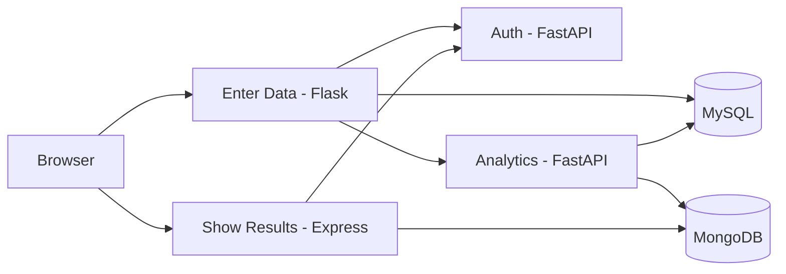

# System architecture

- **Host-exposed:** only Enter Data on localhost:5000 and Show Results on localhost:3000.
- **Internal:** Auth, Analytics, MySQL, and MongoDB stay on private Docker networking.
- **Storage:** MySQL `mysql_data`; MongoDB `mongo_data` volumes.
- **Failure behavior:** If MongoDB is down while writing data, the raw reading remains in MySQL; analytics must be retriggered after MongoDB recovers.
